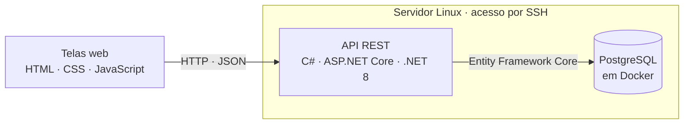

# Olá, eu sou o Luiz Felipe Costa 👋

**Estudante de Sistemas de Informação na PUC Minas · Desenvolvedor back-end em formação · Belo Horizonte, MG**

Busco um **estágio em desenvolvimento back-end** para aprender com um time experiente e contribuir em sistemas reais.

## Sobre mim

- Curso Sistemas de Informação na PUC Minas, com conclusão prevista para 12/2028.
- Desenvolvo APIs e sistemas web com **C# e .NET** e com **PHP**, usando **PostgreSQL** e **MySQL**.
- Gosto de infraestrutura: mantenho um **servidor Linux** em casa, que acesso por SSH e onde rodo meus projetos em **Docker**.
- Tenho interesse em **DevOps, cloud e segurança**, e estudo AWS, Terraform e redes.
- Uso IA generativa como apoio para estudar e desenvolver, sempre conferindo o resultado com testes e documentação.

## Projeto em destaque: Sistema de Gestão de Escalas

Sistema web criado para substituir as planilhas usadas na montagem de escalas de serviço. Foi desenvolvido em um **projeto de extensão da PUC Minas com uma empresa parceira**, e eu fui responsável pelo desenvolvimento, dos requisitos aos testes.

- **API REST** em C# com .NET 8 e ASP.NET Core, documentada e testada com Swagger.
- **Banco PostgreSQL** modelado com Entity Framework Core: code-first, migrations, chaves estrangeiras e índices únicos.
- **Regras de negócio:** lista de prioridade por tempo sem serviço, com contagem separada para dias úteis e para fins de semana e feriados; bloqueio de serviços em dias seguidos; afastamentos; dias permitidos por pessoa; e trocas com registro de quem estava escalado.
- **Interface web** em HTML, CSS e JavaScript puro, com 5 telas que consomem a API e proteção contra XSS.
- **Ambiente:** servidor Linux acessado por SSH, PostgreSQL em Docker Compose e credenciais fora do repositório, com User Secrets.
- **Testes:** gerador de dados fictícios que simulou mais de 260 serviços, conferidos com consultas SQL, e roteiro com 34 casos de teste. O defeito encontrado foi corrigido e retestado.
- **Requisitos e documentação:** entrevista com o usuário do processo, análise das planilhas da operação e registro de mais de 50 decisões técnicas.

**[Ver o código no GitHub](https://github.com/luizz-costa/rodizio-escalas)** 

## Outros projetos

### CMS em PHP e MySQL · projeto pessoal

Sistema de gerenciamento de conteúdo em PHP 8, com POO e MVC: rotas, área administrativa, autenticação, sessões e CRUD, com proteção contra SQL Injection e XSS. Está publicado em hospedagem web e evoluindo para Laravel.

<!-- Se o repositório for público, acrescente aqui: [Ver o código](https://github.com/luizz-costa/NOME-DO-REPOSITORIO) -->

### ControleCerto · projeto acadêmico em equipe

Sistema web de gestão financeira, com dashboard, receitas, despesas e relatórios. Trabalhei nos requisitos, na documentação, na avaliação heurística, nos testes de usabilidade e nas telas, com HTML, CSS, JavaScript e Bootstrap.

<!-- Se o repositório for público, acrescente aqui: [Ver o código](https://github.com/luizz-costa/NOME-DO-REPOSITORIO) -->

## Tecnologias

**Uso em projetos**

C# · .NET 8 · ASP.NET Core Web API · Entity Framework Core · LINQ · Swagger · PHP · Laravel · SQL · PostgreSQL · MySQL · Docker · Docker Compose · Linux · SSH · Git · GitHub · HTML · CSS · JavaScript · Bootstrap

**Estudando**

AWS · Terraform · Python · Shell Script · GitHub Actions · Redes para DevOps · NoSQL (DynamoDB)

## Conceitos que aplico

| Área | Na prática |
|---|---|
| Back-end | APIs REST, POO, MVC, injeção de dependência, validação e respostas de erro padronizadas |
| Banco de dados | Modelagem relacional, normalização, migrations, chaves estrangeiras, índices e consultas SQL |
| Qualidade | Casos de teste, dados de teste fictícios, commits pequenos com Conventional Commits e registro de decisões |
| Segurança | Proteção contra XSS e SQL Injection, credenciais fora do código e cuidado com dados sensíveis |
| Produto | Levantamento de requisitos com o usuário, avaliação heurística e testes de usabilidade |

## No momento

- Aprendendo testes automatizados com xUnit
- Escrevendo os testes automatizados do Rodizio com xUnit
- Aprofundando Docker, Linux e AWS
- Evoluindo no inglês, hoje no nível intermediário (B1)

## Formação e cursos

**Bacharelado em Sistemas de Informação** · PUC Minas · 2025 a 2028

Cursos complementares

- Docker: do básico ao avançado · Udemy
- Formação Linux Completa · Udemy
- AWS Academy Cloud Foundations
- Terraform: Fundamentos de Infraestrutura como Código · Udemy
- Fundamentos de Redes para DevOps · Udemy
- Python para automação de tarefas · Udemy
- PHP Programando com Orientação a Objetos e Design Patterns · Pablo Dall'Oglio
- Sensibilização para Segurança Digital · Cisco

---

Quer conversar sobre uma vaga ou um projeto? Me chame no [LinkedIn](https://www.linkedin.com/in/luizz-costa/).
